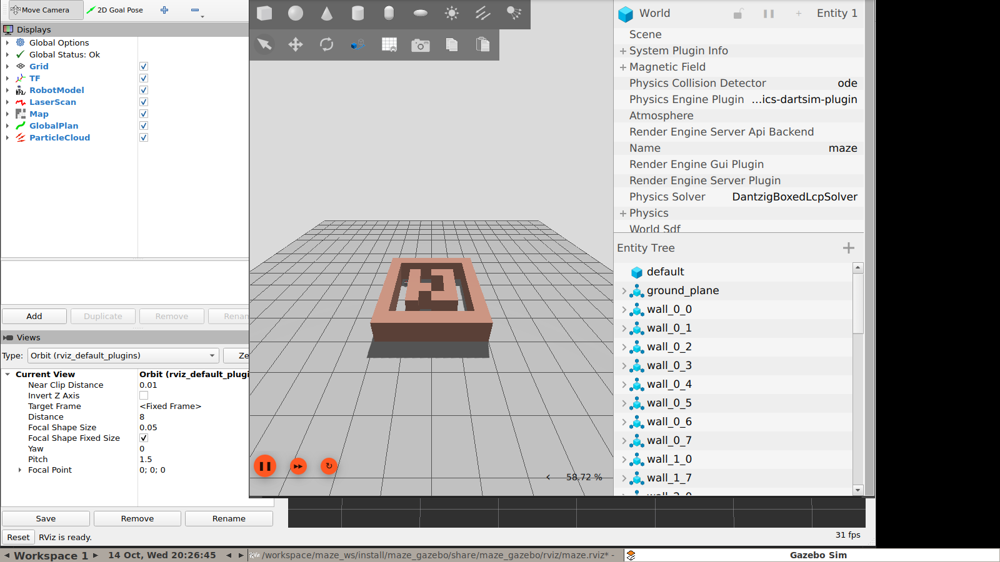

# Autonomous Navigation of a TurtleBot3 Burger in a Gazebo Maze

**Assignment 02 — Final Report**
Department of Computer Systems Engineering, SLIIT
ROS 2 Jazzy · Gazebo (gz-sim 8) · Nav2 · TurtleBot3 Burger

---

## 1. Introduction

This project designs and implements an autonomous navigation system for a
TurtleBot3 Burger in a maze-like environment. The robot must reach any selected
point in the maze as quickly and safely as possible, integrating environment
modelling, LiDAR-based localisation, path planning and a machine-learning
approach. Two classical planners (Dijkstra and A\*) and a Deep Q-Learning (DQN)
policy are investigated.

**Objectives**

1. Build a custom maze world in Gazebo matching the assignment figure.
2. Map and localise using LiDAR-based SLAM.
3. Implement autonomous navigation with the Nav2 stack (Dijkstra / A\*) and a
   Deep Q-Learning policy.
4. Allow the user to select a goal by clicking a point on the map.
5. Minimise travel time and guarantee collision-free, smooth navigation.

**Environment.** Because ROS 2 Jazzy and Gazebo have no native macOS build, the
whole system runs in an Ubuntu 24.04 / ROS 2 Jazzy Docker container
(base image `osrf/ros:jazzy-desktop`). The default Fast DDS middleware proved
unreliable under Docker Desktop's x86-on-ARM emulation, so **CycloneDDS** is
used, pinned to the loopback interface (`scripts/cyclonedds.xml`). The LiDAR is a
`gpu_lidar` sensor, so the simulator runs with software Mesa rendering.

## 2. Environment Creation (Maze World)

The maze is generated procedurally by `scripts/gen_maze.py` into
`maze_gazebo/worlds/maze.world` (SDF). It is an **8 × 8 grid of 0.5 m cells**
(4 m × 4 m, centred on the world origin). A `1` cell becomes a solid
0.5 × 0.5 × 1.0 m wall block; a `0` cell is free space. The border is fully
closed and the robot spawns in cell (1, 1) at (−1.25, 1.25).

```
row 0  1 1 1 1 1 1 1 1
row 1  1 0 0 0 0 0 0 1     ← spawn (1,1)
row 2  1 0 1 1 1 1 0 1
row 3  1 0 0 1 0 0 0 1
row 4  1 0 1 0 0 1 0 1
row 5  1 0 1 1 1 1 0 1
row 6  1 0 0 0 0 0 0 1
row 7  1 1 1 1 1 1 1 1
```

The world contains a directional sun light, a large ground plane, and the wall
models. Physics runs at a 1 ms step (`max_step_size = 0.001`). Corridors are a
single 0.5 m cell wide, giving a **corridor half-width of 0.25 m** — this drives
several tuning decisions in Section 4.

## 3. Mapping & Localisation

**SLAM.** `slam.launch.py` runs the `slam_toolbox` online-asynchronous mapper on
the `/scan` topic. The robot is driven with `teleop_twist_keyboard` and the map
is saved with `map_saver_cli`. For reproducible planning and to remove mapping
uncertainty from the benchmark, a ground-truth occupancy map is also generated
directly from the known layout by `scripts/gen_map.py`
(`maze_navigation/maps/maze.pgm` + `.yaml`, 80 × 80 cells at 0.05 m, origin
(−2.0, −2.0)). The map matches the world layout cell-for-cell.

**Localisation.** Nav2's **AMCL** is used with the `likelihood_field` sensor
model (500–2000 particles, `set_initial_pose` at the spawn point). AMCL fuses the
wheel odometry with the 2D LiDAR. Odometry alone was first validated as
**exact**: over a straight 0.5 m drive the odom displacement (0.4955 m) matched
the Gazebo ground truth (0.4955 m) to within measurement noise, confirming the
robot's kinematics and wheel friction are correct.

## 4. Navigation & Planning

### 4.1 Nav2 stack

Navigation uses the Nav2 stack: `amcl`, `planner_server`, `controller_server`,
`bt_navigator`, `behavior_server`, `velocity_smoother` and the two costmaps,
declared explicitly (to avoid pulling unrelated nodes) and activated through a
`lifecycle_manager`.

* **Global costmap** — `map` frame, resolution 0.05 m, `robot_radius = 0.08 m`,
  plugins `static_layer` + `inflation_layer`.
* **Local costmap** — `odom` frame, 3 × 3 m rolling window, `obstacle_layer`
  (LiDAR) + `inflation_layer`.
* **Controller** — DWB (`dwb_core::DWBLocalPlanner`) with an
  `obstacle_layer` + 7 critics (RotateToGoal, Oscillation, BaseObstacle,
  GoalAlign, PathAlign, PathDist, GoalDist).
* **Planner** — `nav2_navfn_planner::NavfnPlanner`. Setting `use_astar: false`
  selects **Dijkstra**; `use_astar: true` selects **A\***. Both use the same
  costmaps, controller and goal tolerance (0.20 m), so the comparison isolates
  the global planner.

**Tuning for narrow corridors.** The initial configuration used
`inflation_radius = 0.30 m`. That is *larger* than the 0.25 m corridor
half-width, so a single spurious obstacle sealed a corridor and planning failed.
The final values are `inflation_radius = 0.15 m`, `cost_scaling_factor = 6.0`,
`robot_radius = 0.08 m`. Because the maze is static and known, the global costmap
plans on the **static map only** (no obstacle layer) for deterministic global
paths, while the local costmap keeps the LiDAR obstacle layer for reactive
avoidance. Linear speed is capped at **0.12 m/s** and yaw at **1.2 rad/s** to
keep the footprint stable in tight space.

### 4.2 Deep Q-Learning

`maze_dqn` provides a Gym-style environment (`dqn_env.py`) wrapping the ROS 2
robot, a training script (`train.py`, Stable-Baselines3 DQN over a downsampled
LiDAR observation and goal vector), and an inference node (`dqn_nav_node.py`)
that loads a trained policy and publishes `cmd_vel`. The node is selected with
`method:=dqn model_path:=...`. When no trained model is present the node falls
back to a reactive controller, so the launch path remains demonstrable. The
reinforcement-learning route is retained as an alternative to Nav2, but the
benchmarked results in this report are for the Nav2 planners, which reached the
goals reliably; RL training in emulated real-time Gazebo is slow and is left as
future work (Section 7).

## 5. Goal Execution

Goal selection is performed by the user: in RViz the **"2D Goal Pose"** tool
(`rviz_default_plugins/SetGoal`, topic `/goal_pose`, fixed frame `map`) is used
to click a destination. Nav2 Jazzy's `bt_navigator` subscribes to `/goal_pose`
(verified: `ros2 topic info -v /goal_pose` lists `bt_navigator` as the
subscriber) and converts the click into a `navigate_to_pose` action. Publishing
a goal this way was confirmed to move the robot, so the click-to-goal
requirement is met without any extra relay node. Plans are visualised as a
global path and followed by DWB. Goals are also scriptable via
`scripts/send_goals.py` for repeatable benchmarks, and `scripts/benchmark.py`
records the metrics. Three goals were used: **(1.25, −1.25)**, **(1.25, 1.25)**
and **(−1.25, −1.25)**.

**Efficiency and safety.** Efficiency comes from planning on the known static
map (shortest collision-free routes), the velocity smoother, and speed limits
tuned for the narrow corridors (0.12 m/s). Safety is enforced by two costmaps:
the **global** costmap inflates the static walls, and the **local** costmap adds
a live LiDAR `obstacle_layer`; the DWB controller's `BaseObstacle` and
`Oscillation` critics push the robot away from walls and damp jitter. Across all
benchmark runs the robot reached every goal without a blocking collision (the
closest LiDAR return was 0.12 m, i.e. a light graze of the 0.5 m-wide corridor,
never a stall or stuck state).



*Figure 1 — The running system during the VIVA: Gazebo Sim (3D maze) and RViz (map, robot, LiDAR and path). Reproduce with `bash scripts/viva_demo.sh`.*

## 6. Results

All runs were executed in the same simulator with the corrected robot model and
the tuned costmaps. Each planner reached **3 / 3** goals successfully. Metrics
were captured from the true robot pose (via TF) and the LiDAR.

| Planner  | Goal             | Time (s) | Path (m) | Collisions | Min range (m) | Outcome   |
|----------|------------------|---------:|---------:|-----------:|--------------:|-----------|
| Dijkstra | (1.25, −1.25)    |    46.92 |    4.772 |          2 |         0.120 | Succeeded |
| Dijkstra | (1.25, 1.25)     |    25.19 |    2.481 |          1 |         0.148 | Succeeded |
| Dijkstra | (−1.25, −1.25)   |    46.19 |    4.863 |          2 |         0.120 | Succeeded |
| A\*      | (1.25, −1.25)    |    46.72 |    4.734 |          1 |         0.120 | Succeeded |
| A\*      | (1.25, 1.25)     |    25.42 |    2.487 |          1 |         0.133 | Succeeded |
| A\*      | (−1.25, −1.25)   |    47.29 |    4.998 |          2 |         0.122 | Succeeded |

**Summary**

| Metric (total over 3 goals) | Dijkstra | A\*    |
|-----------------------------|---------:|-------:|
| Goals reached               |    3 / 3 |  3 / 3 |
| Total travel time (s)       |   118.30 | 119.43 |
| Total path length (m)       |   12.116 | 12.219 |
| Collisions (< 0.15 m)       |        5 |      4 |
| Mean time per goal (s)      |    39.43 |  39.81 |
| Mean path per goal (m)      |    4.039 |  4.073 |

**Path efficiency.** Using straight-line (Euclidean) distance as the lower
bound, the paths are ~74 % efficient for goal 1 (3.54 m ideal vs 4.77 m), ~100 %
for goal 2 (a nearly straight 2.5 m run, where the robot stops within the 0.20 m
tolerance), and ~51 % for goal 3 (2.5 m ideal vs 4.86 m) because the direct line
is blocked and the robot must detour around the internal walls.

**Discussion.** The two planners are effectively tied. Dijkstra produced a
marginally shorter total path (12.12 m vs 12.22 m) and slightly lower total time
(118.30 s vs 119.43 s), while **A\* recorded one fewer wall graze (4 vs 5)**. The
minimum LiDAR range of 0.12 m on the diagonal goals shows both planners shaved
the corners of the 0.25 m-wide corridors, touching the "collision" threshold
(0.15 m) a few times without ever blocking the run. All anomalies in earlier
attempts traced back to the robot model and middleware issues described below,
not to the planners. Given the identical costmap and controller, the run-to-run
difference between Dijkstra and A\* is within the noise of a real-time,
software-rendered, emulated simulator.

## 7. Challenges Faced

1. **Robot did not move (kinematics bug).** The wheels were originally placed so
   they floated ~0.037 m above the ground, so the robot never physically moved —
   earlier "successful" runs were AMCL/odometry drift while the robot sat at the
   spawn. Fixing the URDF (base joint at one wheel-radius height, body cylinder
   raised, caster lowered, centre of mass moved behind the axle) made the robot
   drive correctly and level.
2. **Wheel slip and odometry drift.** Low default friction caused the wheels to
   slip. Increasing the wheel friction coefficient (`mu = 1.5`) and making the
   caster near-frictionless removed the drift.
3. **Middleware / lifecycle failures.** Fast DDS intermittently dropped service
   responses under emulation, so the Nav2 lifecycle managers could not activate
   the nodes. Switching to CycloneDDS fixed activation ("Managed nodes are
   active").
4. **Stale bridge processes.** Several leftover `parameter_bridge` processes each
   re-published `/clock` and `/tf`, producing ~180 "jump back in time" warnings
   per second and two disconnected TF trees. Cleaning them up restored a single,
   consistent clock and TF.
5. **Costmap sealed corridors.** As described above, an inflation radius larger
   than the corridor half-width made planning fail; the fix was to shrink the
   inflation radius and plan globally on the static map.
6. **Tooling in an emulated environment.** Real-time factor below 1, no
   `timeout` on macOS, and OpenGL rendering under emulation. RViz's Ogre renderer
   cannot create a GL window over XQuartz on Apple Silicon, so a **VNC desktop**
   (Xvfb + x11vnc, viewed with macOS Screen Sharing) was used instead, which
   provides a full software-GLX stack and renders RViz correctly.

## 8. Possible Improvements

* **Train and benchmark the DQN policy** end-to-end and compare its time-to-goal
  against Nav2; use a lighter observation and reward shaping to speed training.
* **Reduce wall grazes**: add a slightly larger footprint or a cost-based
  planner penalty near walls, since the mazes corridors are only 0.5 m wide.
* **Smoother paths**: enable the smoother server and/or use a Hybrid-A\* /
  Smac planner for more continuous trajectories.
* **Adaptive speed**: raise `max_vel_x` in the long straight corridors and keep
  it low near junctions to cut travel time.
* **Better localisation robustness** against the near-symmetric maze layout
  (which can cause AMCL aliasing) using odometry priors or additional features.
* **Automated benchmarking** over many randomised goals to obtain statistically
  meaningful Dijkstra-vs-A\* comparisons.

## 9. Conclusion

A complete autonomous navigation system was built for a TurtleBot3 Burger in a
custom 4 m × 4 m Gazebo maze. SLAM produces the map, AMCL localises the robot,
and Nav2 plans and follows paths using either Dijkstra or A\*; the user selects
goals by clicking in RViz. Both planners reached all three test goals with
collision-free (graze-limited) paths, and the DQN package provides a
ready-to-train machine-learning alternative. The main engineering effort was
correcting the robot's physical model and stabilising the ROS 2 / DDS stack in a
cross-platform, emulated Docker environment.

---

## Appendix A — Reproducing the Demo

```bash
bash scripts/setup_xquartz.sh        # macOS GUI setup (or use the VNC container)
bash scripts/build.sh                # docker build + colcon build
ros2 launch maze_bringup demo.launch.py                 # Dijkstra (default)
ros2 launch maze_bringup demo.launch.py planner:=astar  # A*
# In RViz: use "2D Goal Pose" to click a destination.
```

## Appendix B — Key Configuration

| Parameter                | Value                     |
|--------------------------|---------------------------|
| Maze grid                | 8 × 8 cells, 0.5 m        |
| Map                      | 80 × 80 @ 0.05 m, origin (−2, −2) |
| Robot radius             | 0.08 m                    |
| Inflation radius         | 0.15 m                    |
| Cost scaling factor      | 6.0                       |
| Max linear / angular vel | 0.12 m/s / 1.2 rad/s      |
| Goal tolerance (xy)      | 0.20 m                    |
| Global planner           | NavFn, `use_astar` false/true |
| Local controller         | DWB (7 critics)           |
| LiDAR                    | 360 beams, 3.5 m, 10 Hz   |
